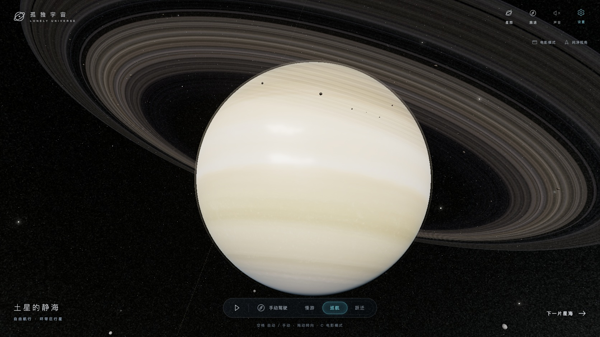
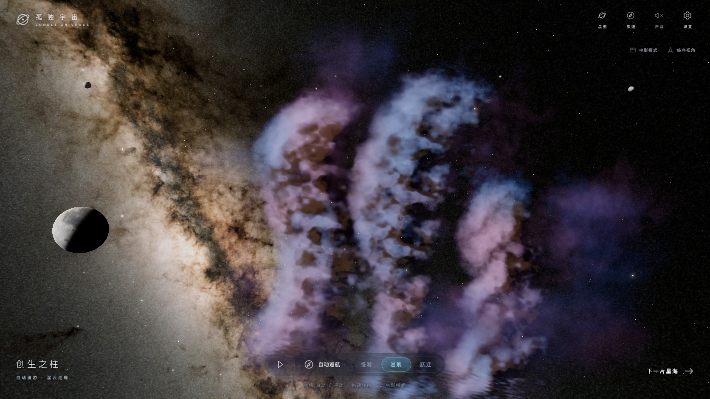
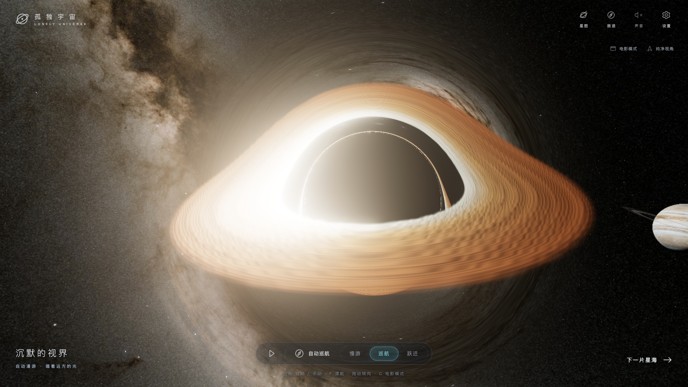

<div align="center">

# LonelySky Engine

**A procedural universe, from a seed to a scene.**

确定性宇宙生成 · 体积星云 · 行星与光环 · 黑洞 · 三维星系

[Play the full game / 在线体验](https://lonelysky.app/) · [Quick start](#quick-start) · [API](docs/api.md) · [中文说明](#中文说明)

[](https://lonelysky.app/)

*Actual gameplay capture. The live showcase opens the normal LonelySky game.*

</div>

LonelySky Engine creates reproducible space scenes from a seed and renders them
with an optional Three.js adapter. Build an explorable universe, embed a space
background, or use individual celestial materials in your own application.

The pure JavaScript core runs without dependencies in Node.js and modern browsers.
The optional renderer uses the application's existing Three.js installation or
import map. There is no AI service, account requirement, or runtime backend.

| Layer | Included |
| --- | --- |
| Generation | Seeded sectors, five planet types, rings, stars, binaries, nebulae and black holes |
| Rendering | Procedural planet surfaces, atmospheres, rings, volumetric nebulae and black holes, sparse 3D galaxies, bloom |
| Streaming | 125 neighboring cells, continuous distance fading, floating-origin coordinates, quality levels |
| Simulation | Elliptic Kepler orbits, sampled gravity, continuous moving-sphere collision and safe-pose recovery |

## Live showcase

**[Enter LonelySky →](https://lonelysky.app/)**

The showcase is the complete game, including its flight, cinematic cameras,
home planets and social features. Those product features and the game's art
direction are separate from this reusable engine. The SDK's default seed generates
its own procedural world; it does not reproduce the game's authored opening,
textures or private world configuration.

| Volumetric nebula | Black hole |
| --- | --- |
| [](https://lonelysky.app/) | [](https://lonelysky.app/) |

These are gameplay screenshots, not screenshots of the minimal integration
example. [Showcase credits](docs/showcase-credits.md).

## Quick start

Clone the source or use it as a Git submodule. The package remains source-only
and is not published to npm.

```sh
git clone https://github.com/Ares-X/LonelySky-Engine.git
cd LonelySky-Engine
npm test
npm run dev
```

Open `http://127.0.0.1:4180/` for the small **embedding example**. It loads pinned
Three.js 0.186.1 from jsDelivr and therefore needs network access. It contains a
scene, not the game's controls. Use `PORT=4190 npm run dev` to choose another port.
The live game above remains the main visual demo.

### Generate a universe

```js
import { createUniverse, encodeCell, createGravityField } from './src/index.js';

const universe = createUniverse({ seed: 'first-light', density: 0.65 });
const address = encodeCell({ x: 0, y: 0, z: 0 });
const description = universe.getSector(address); // Plain, serializable scene data.
const gravity = createGravityField({ world: universe });
const acceleration = gravity.sample(address, [0, 0, 0]);
```

The same seed and options reproduce the same sectors, independent of visit order.
`getSector()` returns scene data; `sector()` returns spheres for physics.
`density` controls local content; distant star and galaxy backgrounds are separate.

Version 0.3 adds stateless `evaluateOrbit` and `evaluateBodyState` helpers. A custom
physics provider can attach an elliptic `orbit` to a body whose `position` is its
fixed focus; gravity, collision and application visuals sample the same time.
Units are caller-defined and must be consistent. These are two-body orbits, not
an N-body ephemeris. The stock rendering example remains static; see the
[orbital API and bounds](docs/api.md#elliptic-orbital-mechanics-03).

Version 0.3.1 filters unresolved stellar detail during camera motion and preserves
integrated light for small star points. Gravity samples also expose the strongest
source's detached position and velocity in the caller's local coordinate frame,
so applications can distinguish infall from outward motion around moving bodies.

### Put it on screen

Configure `three` and `three/addons/` in your application's import map, as shown in
[examples/minimal.html](examples/minimal.html), or use your existing Three.js
setup. Give the container a visible width and height.

```js
import { createUniverse } from './src/index.js';
import { createUniverseView } from './src/three.js';

const universe = createUniverse({ seed: 'first-light' });
const view = createUniverseView(document.querySelector('#universe'), { universe });
view.start();

// Your application owns movement and input.
view.setView({ sectorIndex: 0, position: [0, 0, 0], orientation: [0, 0, 0, 1] });
// Call view.dispose() when removing the scene.
```

Use `setQuality('low' | 'auto' | 'high')`, position the camera yourself, or call
`render(timeInSeconds)` from your own animation loop. Individual materials and
volumes are also exported from `src/three.js`.

### Stellar illumination

`setStellarLighting(material, lights, occluders = [])` updates planet, atmosphere
and ring materials with at most two independent colored sources and two spherical
occluders. Each light supplies `{ offset: [x,y,z], color, intensity, radius }`;
occluders supply `{ offset: [x,y,z], radius }`. Offsets use world axes relative to
the receiving planet's center, so floating-origin translations do not change the
lighting. Sample both emitters and receivers at the same simulation time. Colors
are 24-bit sRGB integers; intensity is scene exposure, not SI luminosity.

`setPlanetRingShadow(planetMaterial, { normal, texture, seed, enabled: true })`
adds the matching annular shadow for a ring with inner/outer radius 1.18/2.26 times
the planet radius. Supply the actual world-axis ring normal and the same borrowed
alpha texture and seed as `ringMaterial`. Neither setter owns texture disposal.

The adapter preserves existing directional `lightDir` behavior until the stellar
setter is called. An empty light list explicitly removes direct illumination.
Finite-source eclipses and three-sample ring penumbrae are bounded approximations;
they do not add shadow-map passes or simulate multiple scattering. Source discovery
and exposure selection remain the consuming world's responsibility.

### Directional stellar light

`relativeStarFlux(magnitude, referenceMagnitude)` computes relative linear light
on the astronomical magnitude scale. `starLinearColor(kelvin, output)` provides
a continuous, white-balanced Planck-band color approximation, with unit linear
RGB luminance. It is an artistic camera response, not a CIE stellar spectrum.

The optional `createDirectionalStars({positions, colors, flux, magnitudes, ranks})`
adapter consumes caller-owned typed arrays. Spatial population and magnitude
visibility remain separate. Its Gaussian core and faint wings integrate pixel
coverage before the existing scene tone mapper; they do not use a star catalog,
another renderer, or an automatic exposure loop. Update the `ratio` uniform with
the actual drawing pixel ratio and call `userData.dispose()` when finished.

## Documentation

- [Generation, rendering and lifecycle API](docs/api.md)
- [Coordinates, gravity and collision contracts](docs/physics.md)
- [Game integration and source boundary](docs/integration.md)
- [Showcase credits](docs/showcase-credits.md)

Node.js 22.13+ runs the pure-core tests without installing packages. WebGL2 is
required for rendering. `npm run test:render` additionally needs Three.js 0.186.1
provided by the consuming project. The existing game supplies that installation;
this source repository does not install or bundle it.

The scene uses artistic scales and optical approximations. It is not an
astronomical ephemeris or a rigid-body simulator. See the physics contract for
spatial query and recovery bounds.

## 中文说明

这是可复用的宇宙生成引擎：传入种子得到确定性星区数据，再通过可选的
Three.js 渲染层显示行星、光环、星云、黑洞和三维星系。也可以只使用纯数据、
坐标、引力和碰撞模块。

**效果演示直接使用[正常游戏](https://lonelysky.app/)**。仓库中的最小示例用于
说明如何嵌入自己的网页；完整游戏的飞船操控、自动巡航、家园、联机、存档、
后端、品牌和专属世界配置继续由游戏维护。

## License

Source code: [Apache-2.0](LICENSE), with attribution in [NOTICE](NOTICE).
The gameplay screenshots depict separately credited artwork; see
[showcase credits](docs/showcase-credits.md). Game textures are not distributed
as engine runtime assets.

Version 0.3.2 keeps the planet limb and atmosphere powers inside their defined
floating-point domains, and removes undefined negative-base powers and the
undefined central angular phase from galaxy haze. Generation seeds and saved
coordinates are unchanged. Numerical shader tests cover float32 facing extrema,
vertical disk symmetry and the finite axis limit; they are not a GPU emulator.

Version 0.4 adds six seeded galaxy appearance families: open spirals, barred
spirals, dusty edge-on disks, old stellar halos, tidal islands and compact young
clusters. They share the existing volume and particle renderer. Appearance uses
its own random stream, leaving galaxy addresses and particle prefixes unchanged.
`describeGalaxyAppearance` exposes the structural controls and suggested local
view offset/FOV; the application owns destinations, names and navigation.

The unreleased V3 open-cluster particle sampler uses a narrower vertical Gaussian
and a smooth outer tail within the existing support. This removes the dense
spherical rim caused by clipping Gaussian outliers onto one radius. The cluster
becomes thinner and more concentrated while retaining a 3D population; individual
V3 open-cluster tracer positions change. Descriptor identity, radius, orientation,
colors, sizes and exact quality prefixes are retained. Legacy revision 1 and other
structure families retain their existing samples. These tracers are scenery;
body placement, gravity, collision and application bookmarks have separate owners.

The legacy cosmic sampler prepares descriptor rotation and linear colors once,
then writes directly into its typed buffers. This preserves exact generated
positions, colors, sizes and quality prefixes while removing repeated conversion
work and short-lived arrays. Cold batches are still synchronous; this change
does not establish a browser frame-time budget or remove first-visit stalls.

Version 0.5 adds optional astronomy-inspired appearance adapters. Natural planets
with stable IDs can use ten seeded surface families through
`describePlanetAppearance` / `PLANET_APPEARANCE_FAMILIES`; explicit texture maps,
explicit procedural surfaces and home descriptors keep their existing behavior.
`describeNebulaAppearance` selects emission, reflection, dark dust, planetary
shell or supernova-remnant treatments. Pass its result as `appearance` to
`createNebula`; omitting it retains the existing volume treatment.

`createStellarRemnant(body)` renders a `stellarFamily` of `brown-dwarf`,
`white-dwarf`, `neutron-star`, `pulsar` or `red-giant`. Supply a positive `radius`
and optionally a `seed`, `color`, `phase`, `spinTilt` and `magneticTilt`. Place the
returned group in your floating-origin scene, call
`group.userData.update(celestialTime, camera, visibility, quality, reducedMotion)`
each frame, and call `group.userData.dispose()` when removing it. The core uses
the supplied body radius; coronae and beam illustrations are
non-solid. The application owns world placement, encounters, catalogs and safety.
These are bounded artistic shaders, not stellar evolution or radiation simulations.

Version 0.10.4 reduces temporary allocations in cosmic bounds queries. Cached
body lookups no longer allocate a cell array, queries reuse their own candidate
address, and discarded bodies do not allocate result positions. Public queries
still return independent result arrays and positions; descriptor seeds, wrapped
coordinates, query order and the existing 4096-entry descriptor cache are unchanged.

Version 0.10.1 sets the canonical V3 structure support fade interval to
125–150 million world units (previously 80–100 million). The fixed 5³ streaming neighborhood, catalogue, particle
counts and quality levels are unchanged. Even at cell and torus seams, omitted
parent supports remain at least 157.8748 million units away; their children fit
inside those supports. This changes visibility only, preserving generated
descriptors, seeds, coordinates and physics. Legacy cosmos fade is unchanged;
custom/wrapped providers retain per-sample fading instead of canonical support
weights (with the shared V3 horizon when `structures: true`). These bounds assume
a rebased camera within half a cell of its sector origin.

`createCosmos().userData.update(frame)` optionally accepts a current Three.js
`PerspectiveCamera` as `frame.camera`. V3 haze then skips volumes wholly outside
the four viewport sides, using the world-space ellipsoid support of the actual
unit-sphere proxy, including ancestor translation, rotation, scale and shear. Physical
near/far planes are excluded because radial depth compression preserves
directions rather than true distances. Camera rotation, FOV changes and rebases
re-evaluate admission without changing optical weights, integration or buffers.
Omitting the camera, using a non-perspective camera, or using the legacy cosmos
path retains the previous behavior. The bundled view supplies its actual camera.
